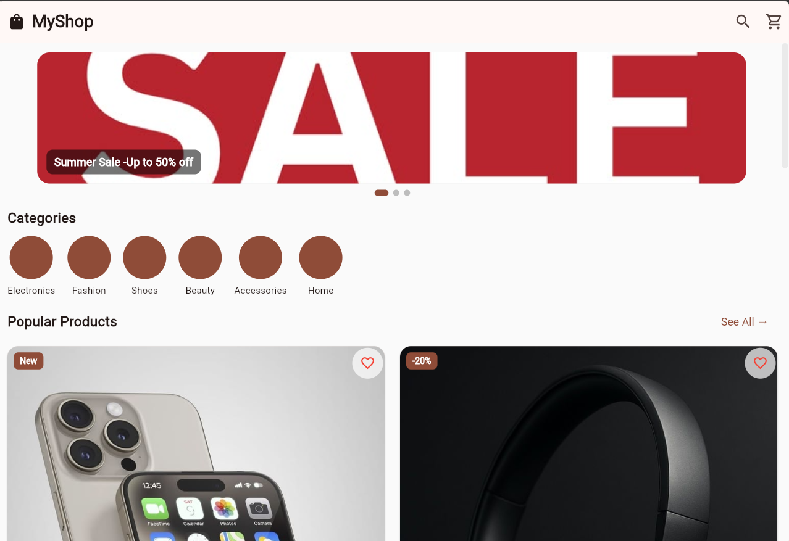
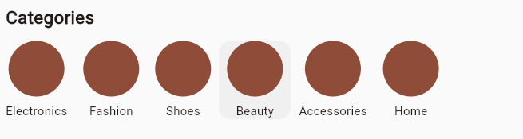
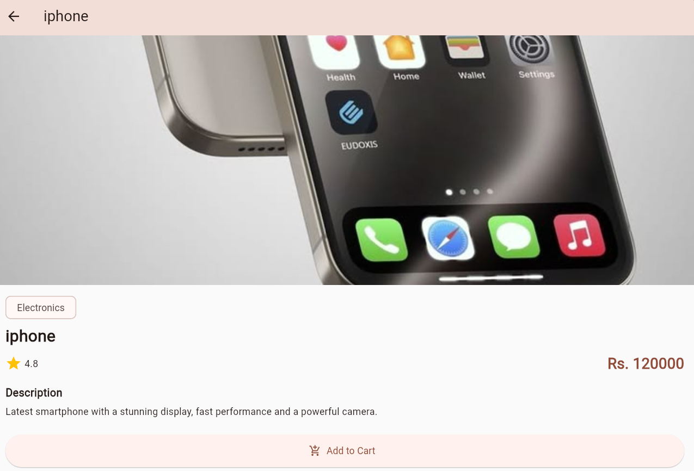

# MyShop – Mini E-Commerce Application

Student Name: Shulabh Shah
Course: Mobile Application Development – Flutter

## Description
MyShop is a mini e-commerce mobile application built with Flutter. Users can browse products by category, move from the home page to a category page, and open a details page for any product. The app uses static local data, with no backend, login, or payment.

## Features
- AppBar with app name, search icon and cart icon
- Auto-playing banner carousel with 3 promotional banners
- Horizontal scrolling category list with 6 categories
- Reusable `ProductCard` widget (Card, Container and Stack with badge and favorite icon)
- Category page using `GridView.builder`, filtered by the selected category
- Product Details page showing image, name, price, rating, category and description
- Add to Cart button that shows a SnackBar message
- Navigation between 3 screens, passing the selected category and product

## Screenshots
| Home Page                                  | Category Page                                        | Product Details                                  |
|--------------------------------------------|------------------------------------------------------|--------------------------------------------------|
|  |  |  |

## Project Structure
```
lib/
├── main.dart
├── models/
│   └── product.dart
├── data/
│   └── product_data.dart
├── screens/
│   ├── home_page.dart
│   ├── category_page.dart
│   └── product_details_page.dart
└── widgets/
    ├── product_card.dart
    ├── category_item.dart
    └── banner_carousel.dart
```

## Packages Used
- [carousel_slider](https://pub.dev/packages/carousel_slider) – creates the auto-playing, swipeable banner carousel on the home page without writing the paging and timer logic by hand

## How to Run
1. Install Flutter and clone this repository
2. Run `flutter pub get`
3. Run `flutter run`